# superfar

A dual-pane file manager for Linux in the Directory Opus mould, at
Thunar's weight, with FAR-style function keys. Keyboard first, one
window, and it never defines a colour: whatever your platform theme
says is what it looks like.

> This is my file manager. There are many like it, but this one is mine.
>
> My file manager is my best friend. Without me, my file manager is
> useless. Without my file manager, I am `ls`.

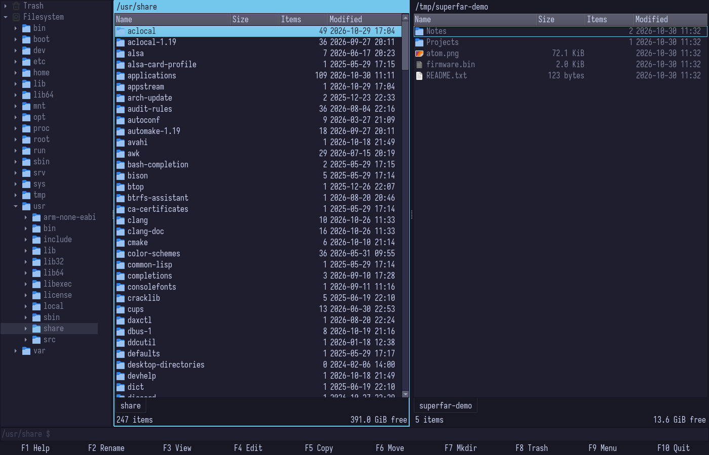

[Install](#install) · [Features](#features) · [Screenshots](#screenshots) ·
[Keys](#keys) · [Mouse](#mouse) · [Columns](#columns) ·
[Permissions and owner](#permissions-and-owner) · [Config](#config) ·
[Building](#building-from-source) · [Status](#status-and-limits)

## Why

Thunar is light but slow to improve, and Linux has had no dual-pane
manager that feels native rather than borrowed from GNOME or KDE.
superfar keeps the Opus workflow (tree, two panes, tabs, preview,
folder sizes) and the Thunar footprint, and puts every action on a key
you can see in the bar at the bottom.

## Install

Each [release](https://github.com/crustovsky/superfar/releases) carries
two files, both built on Arch and needing its library generation (Qt
6.12, glib 2.90 and glycin 2 or newer):

- a pacman package: `pacman -U superfar-*.pkg.tar.zst`
- a binary tarball whose `install.sh` copies it under `~/.local` or a
  prefix you name

Anywhere else, [build it from source](#building-from-source). To make it
the default for folders:

```sh
xdg-mime default superfar.desktop inode/directory
```

Some features lean on a tool that may not be installed. Without it the
window says so when you reach the feature, or the preview keeps the
thumbnail; nothing else changes.

| Tool | Used for |
|---|---|
| bsdtar (libarchive) | archives: open, extract, pack |
| tumbler | thumbnails |
| pdftoppm and pdfinfo (poppler) | PDF pages in the preview |
| ffmpeg and ffprobe | video in the preview |
| gvfs | the trash, mounts and network shares |
| xdg-terminal-exec or `$TERMINAL` | F4 and the command line |

## Features

### The window

| | What you get | Where |
|---|---|---|
| **Two panes** | Always open, each with its own path bar, tabs and status line; the active one is unmistakable. | Tab, Ctrl+F1, Ctrl+F2 |
| **Tabs** | A tab owns its folder, history, sort, filter, marks and cursor. Tabs come back on start and can be locked. | Ctrl+T, Ctrl+W, Ctrl+Shift+L |
| **Folder tree** | One tree that follows the active tab: the filesystem, the trash, your GTK bookmarks, mounts and the network. | Shift+Tab, Ctrl+F5 |
| **Function key bar** | F1 to F10 with what they do, relabelled while Shift, Ctrl or Alt is held. The menu bar stays out of the way until F9, and a right click offers the same commands for what is under the pointer. | always on screen |
| **Columns** | Size, Items, Modified, Permissions, Owner. Drag a header to reorder, right click it to choose; each pane keeps its own. Size, count and date are never cut short. | Ctrl+F6, the header |

### Working with files

| | What you get | Where |
|---|---|---|
| **Quick filter and marks** | Just type to filter. Marks are separate from the cursor and come back when you return to a folder. | typing, Insert, Space, Ctrl+A |
| **Copy, move, trash** | A job strip inside the window: progress for items and bytes, a throughput graph, Pause, Skip and Abort, conflicts and errors as bars, and an unattended mode that logs instead of asking. | F5, F6, F8 |
| **Permissions and owner** | `rwxr-xr-x` and `user:group` in the list as `ls -l` has them, sortable, edited in the row. For many items at once, and down their folders, in the properties panel. | F2 then Tab, Alt+F2 |
| **Archives** | Open as read-only folders, extract with F5, pack the marked items into zip, tar.gz, tar.xz, tar.zst or 7z. | Enter, F5, Alt+F5 |
| **Multi-rename** | Wildcards, regex, find and replace, numbering, case, presets and undo, with a live preview that calls out clashes. | Shift+F2 |
| **Folder sync** | Compares the two panes by size, time and, if asked, SHA-256; copies or trashes what you check. | Shift+F5 |

### Looking and finding

| | What you get | Where |
|---|---|---|
| **Folder counts and sizes** | Item counts by default; recursive sizes and counts per tab, with partial totals while the walk runs. | Ctrl+F3, F3 on a folder |
| **Preview** | Follows the cursor in the other pane or a third slot: images, text, PDF pages, video, an archive's summary and tree, a folder's totals. | Ctrl+F8 |
| **Viewer** | Any file of any size, read in windows; hex for binaries. | F3 |
| **Thumbnails** | From tumbler over D-Bus, in taller rows, per tab. | Ctrl+F4 |
| **Find and go** | Find in tree with the results in a tab, folder history ranked by frecency, a path or a remote URI typed in. | Alt+F7, Alt+F1, Ctrl+L |
| **Remote and removable** | sftp, smb and the rest through GVfs. Mounting asks for credentials inside the window; F8 on a mount unmounts or ejects it. | Ctrl+L, the tree |

### How it behaves

| | What you get | Where |
|---|---|---|
| **Plays well with others** | Clipboard and drag and drop speak the formats other file managers do; the command line runs in the tab's folder in your terminal. | Ctrl+C, Ctrl+X, Ctrl+V, Ctrl+Space |
| **Nothing pops up** | Progress, questions, passwords, the open-with list and errors are bars inside the one window. | |
| **Your theme** | No colour of its own: what the platform theme says (qt6ct, Kvantum, Fusion) is what it looks like. | |
| **Light** | One process, no indexer, no daemon. About 5 MB of its own memory with an empty window, under 50 MB with a 100,000-entry folder open. | |

Nothing decodes media or documents inside the process: images go
through libglycin's sandbox, PDF pages through pdftoppm and video
frames through ffmpeg in child processes (video plays without sound),
archives through bsdtar, thumbnails through tumbler.

## Screenshots

Click one for its full size.

| | |
|---|---|
| 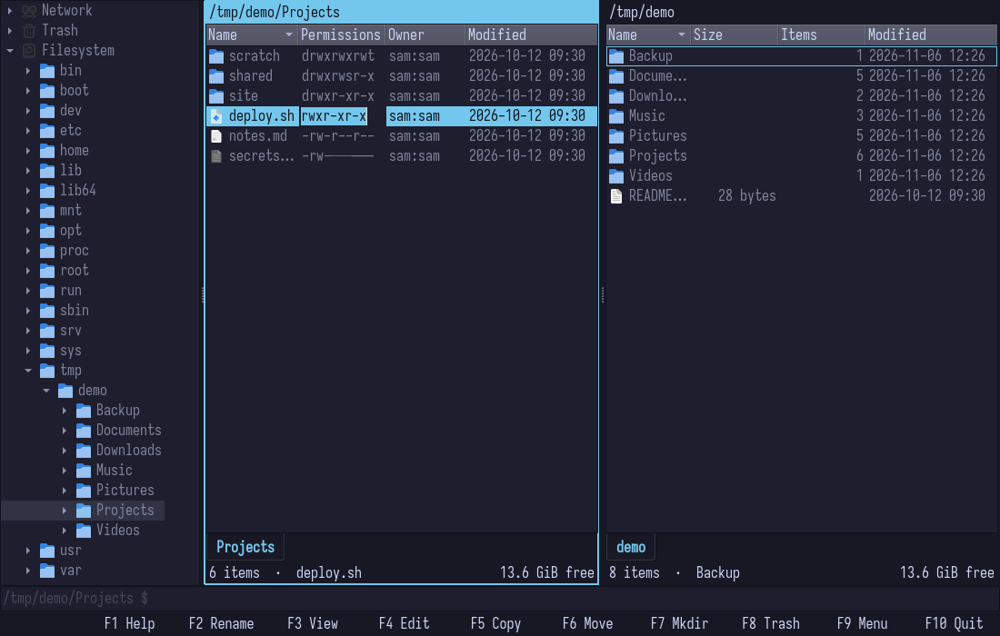<br>Permissions and owner as columns; F2 opens the name, Tab moves to the row's mode | 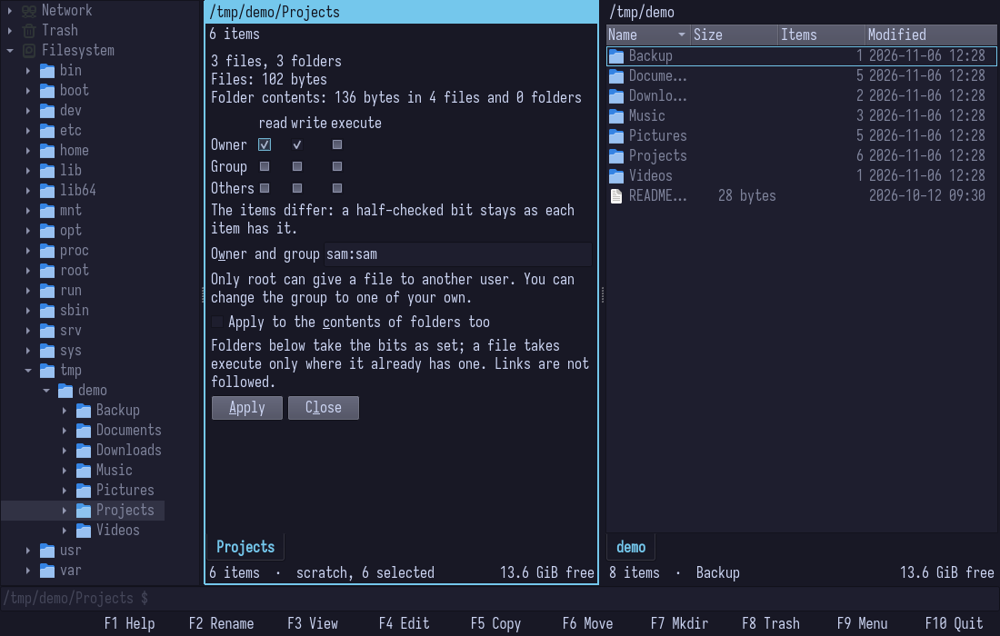<br>Properties on Alt+F2 over several marked items: bits they differ in are half checked and stay |
| 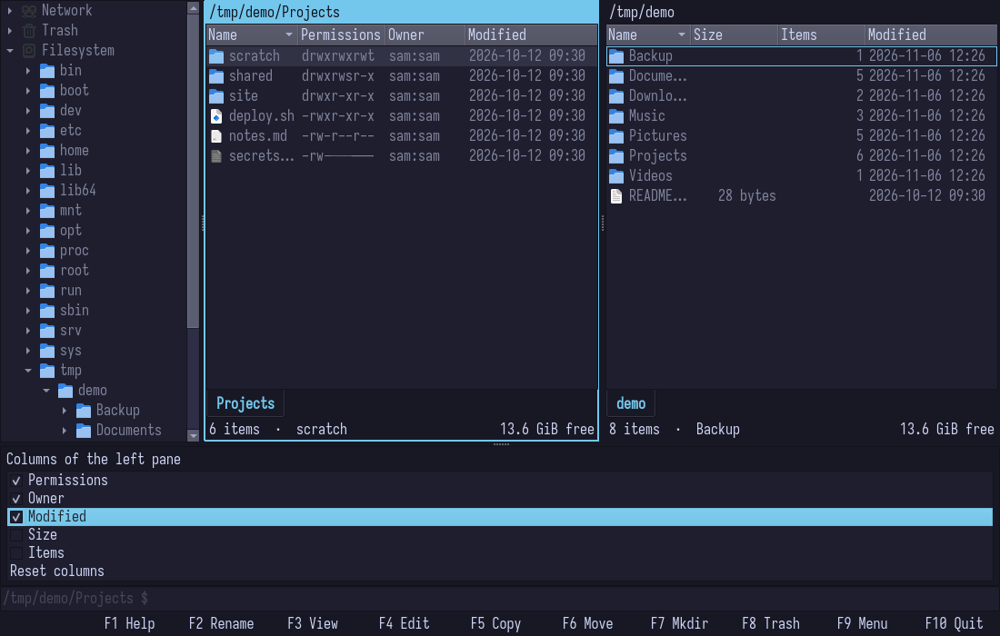<br>The column list on Ctrl+F6: Space shows or hides, Shift+Up and Shift+Down move | 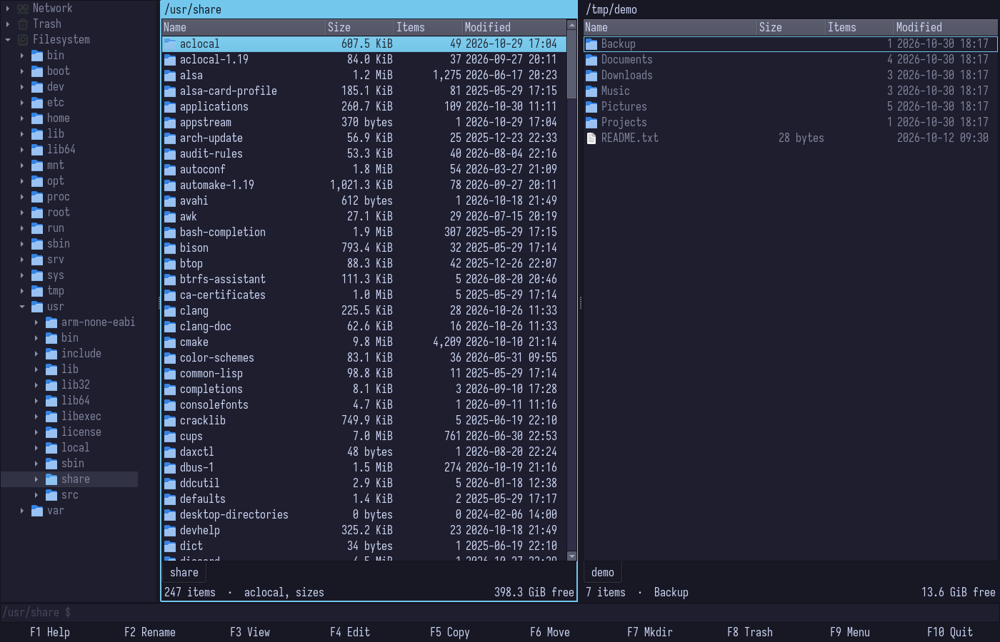<br>Recursive folder sizes on Ctrl+F3, computed in the background |
| 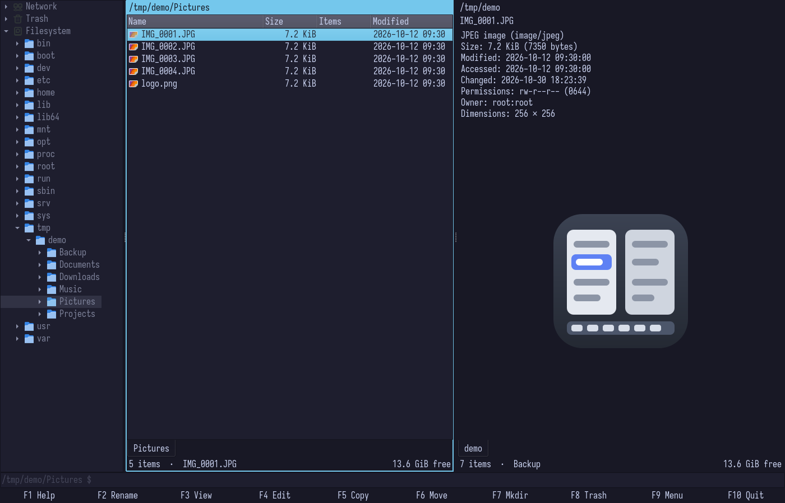<br>The preview on Ctrl+F8, following the cursor | 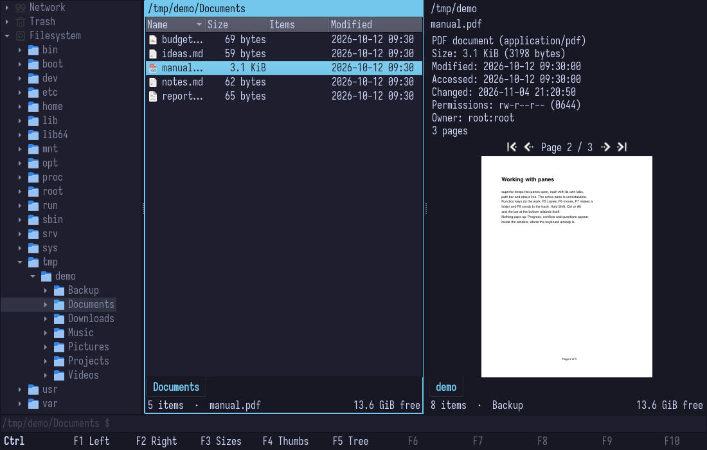<br>A PDF in the preview, paged with Ctrl+PgUp and Ctrl+PgDown or the buttons |
| 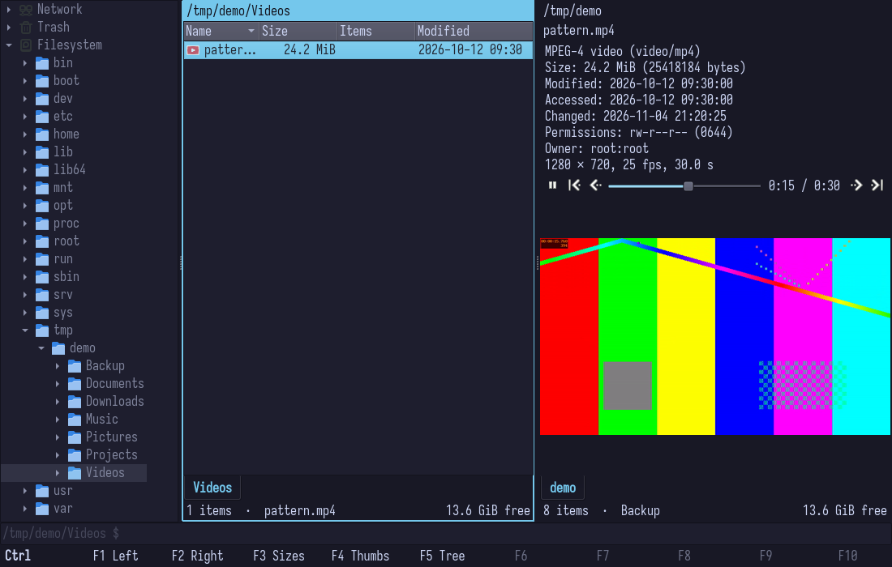<br>A video in the preview, playing after Ctrl+P, without sound; the same keys seek | 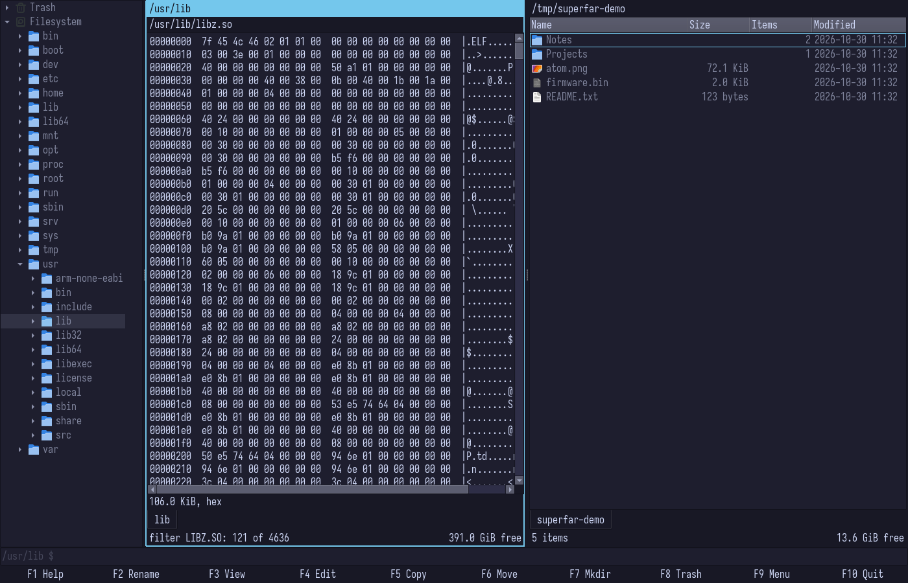<br>The F3 viewer on a binary file |
| 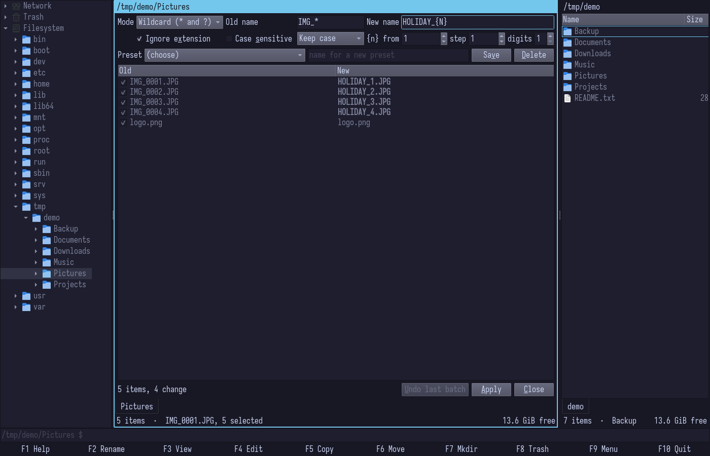<br>Multi-rename on Shift+F2, the clashes called out before anything is renamed | 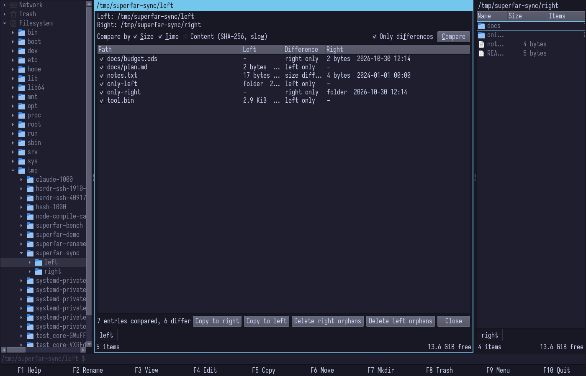<br>Folder sync on Shift+F5, comparing the two panes |
| 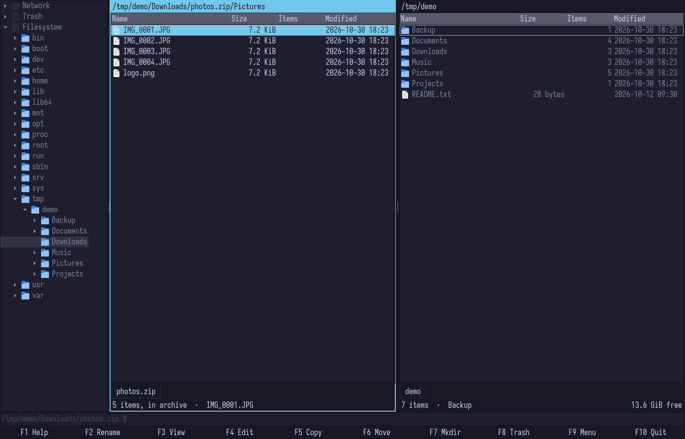<br>An archive opened as a folder, its tab named after it | 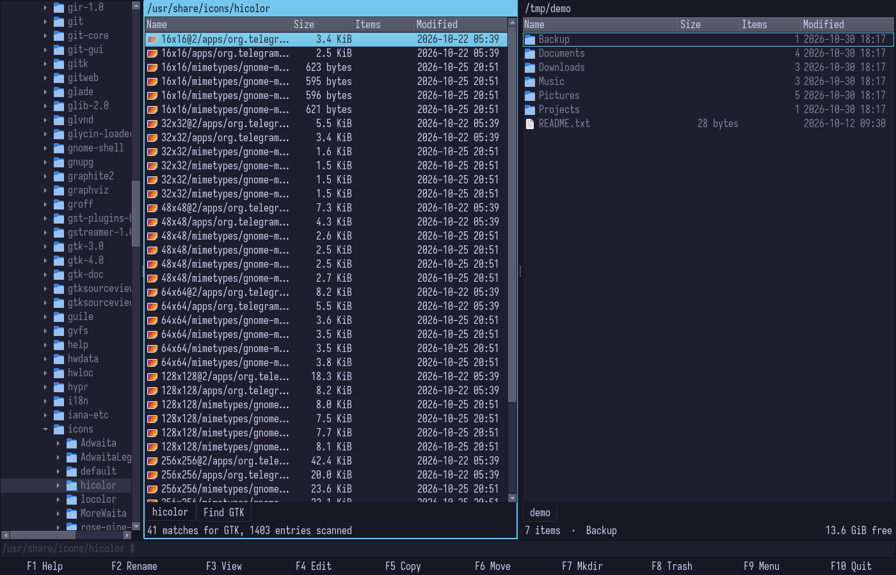<br>Find in tree on Alt+F7, results in a tab |
| 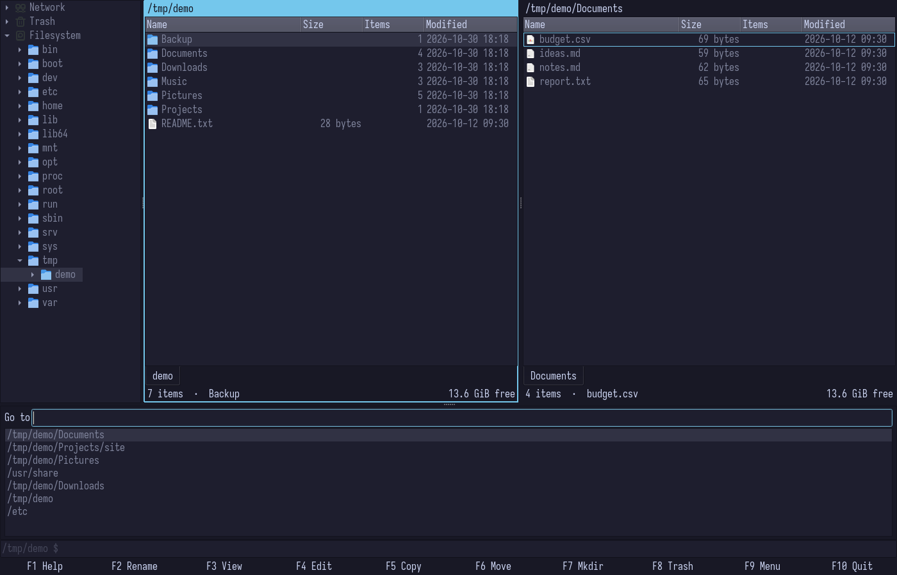<br>Folder history on Alt+F1, ranked by frecency | 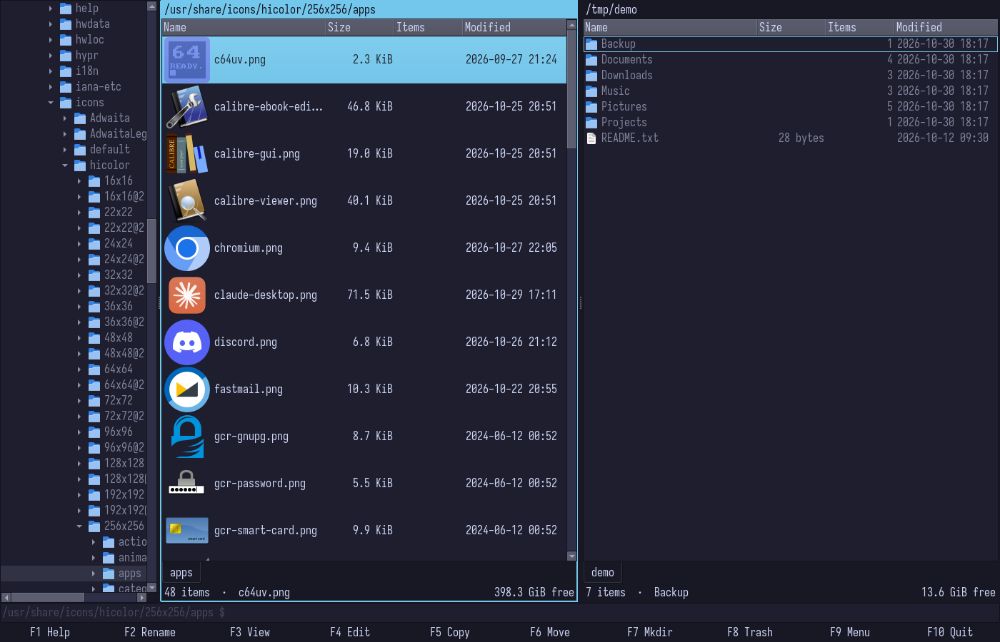<br>Thumbnails on Ctrl+F4, from tumbler through the freedesktop cache |

## Keys

Almost everything is on a function key, in four layers, and the bar at
the bottom shows the layer of whatever modifier you hold, naming the
modifier at its left end. Shift is a variant of the plain key, Ctrl is
what the pane shows, Alt is panels and tools:

| | F1 | F2 | F3 | F4 | F5 | F6 | F7 | F8 | F9 | F10 |
|---|---|---|---|---|---|---|---|---|---|---|
| plain | help | rename | view | edit | copy | move | new folder | trash | menu | quit |
| Shift | about | multi-rename | open with | new file | sync | | | delete | | |
| Ctrl | left pane | right pane | sizes | thumbnails | tree | columns | hidden files | preview | | |
| Alt | go to | properties | | | pack | bookmark | find | | | |

F1 shows the full table inside the window, with whatever you have
remapped. The defaults by subject, with the keys other file managers
use kept as second keys:

### Files

| Key | Action |
|-----|--------|
| Enter | open with the default app; on a folder or an archive, enter it |
| Shift+F3, Shift+Enter | choose an app to open with |
| F2 | rename inline; Tab moves on to the row's permissions and owner when those columns are shown |
| Shift+F2 | multi-rename panel |
| F3 | view; on a folder, compute its size |
| F4 | edit in a terminal ($VISUAL, $EDITOR, else nvim, vim, nano or vi) |
| F5, F6 | copy, move to the other pane (F5 inside an archive extracts) |
| Shift+F5 | folder sync panel |
| Alt+F5 | pack the marked items into a new archive (zip, tar.gz, tar.xz, tar.zst, 7z) in the other pane |
| F7, Shift+F4 | new folder, new file |
| F8, Shift+F8 | trash, delete permanently |
| Alt+F2, Alt+Enter | properties, with permissions and owner for every marked item |
| Ctrl+C, Ctrl+X, Ctrl+V | clipboard, shared with other file managers |

### Marks and filter

| Key | Action |
|-----|--------|
| Insert, Shift+Down | mark and move down |
| Shift+Up | mark and move up |
| Space, Ctrl+A, * | mark, mark all, invert |
| Ctrl+=, Ctrl+- | mark and unmark by pattern |
| Ctrl+Shift+A | clear the marks (a folder's marks come back when you return to it) |
| any text | filters the current tab; Backspace edits the filter while one is set, Space appends to it |
| Esc | clear the filter, close the viewer or panel, close the preview, then clear the marks |

### Moving around

| Key | Action |
|-----|--------|
| Backspace, Left | go up |
| Right | enter the folder |
| Ctrl+L | type a path or URI |
| Alt+F1, Ctrl+G | go to a folder from history |
| Alt+F7 | find in tree |
| Alt+F6, Ctrl+D | bookmark this folder, or remove the bookmark |
| Ctrl+R | reload the folder |
| Tab, Shift+Tab | switch panes, focus the tree |
| F8 in the tree | on a mount: unmount it, or eject it when it is removable |

### Panes, tabs and what they show

| Key | Action |
|-----|--------|
| Ctrl+T, Ctrl+W | new tab, close tab |
| Ctrl+Tab, Ctrl+Shift+Tab | next tab, previous tab |
| Ctrl+Shift+L | lock the tab: navigation opens a new tab |
| Ctrl+F1, Ctrl+F2 | hide the left or right pane |
| Ctrl+F5 | hide or show the folder tree |
| Ctrl+F3, Ctrl+F4 | recursive sizes and counts, thumbnails for this tab |
| Ctrl+F6 | the pane's columns as a list: Space shows or hides one, Shift+Up and Shift+Down move it |
| Ctrl+F7, Ctrl+H | show hidden files |

### Preview

| Key | Action |
|-----|--------|
| Ctrl+F8, Ctrl+Q | preview the cursor item |
| Ctrl+Home, Ctrl+PgUp, Ctrl+PgDown, Ctrl+End | previewed PDF: first, previous, next, last page; video: start, back 10 s, forward 10 s, end |
| Ctrl+P | previewed video: play or pause |

The strip under the preview's details has the same buttons and a
playhead.

### Help, menu and command line

| Key | Action |
|-----|--------|
| F1, Shift+F1 | help; about: name, version and build date |
| F9 | the menu bar until a choice or Esc |
| F10 | quit, keeping the session |
| Ctrl+Space | the command line: runs in the tab's folder in a terminal |

## Mouse

- **Right click** brings a short menu of what the keys do for the thing
  under it, each entry with its key beside it: an item of the list (the
  marked items when there are marks; the menu's first line says which),
  the list's empty space (new folder, paste, what the pane shows), a
  tab, a folder or a mount in the tree.
- **Column headers:** a click sorts and a second click reverses it
  (folders stay first), a drag moves the column, an edge resizes it, a
  right click lists the columns.
- **Tabs:** middle click closes one; a double click on the empty strip
  opens one at home.
- **Path bar:** a double click edits the path (the same as Ctrl+L, for a
  remote location).
- **Drag and drop:** files drag between panes, onto tree folders and to
  other apps, and drops from other apps are accepted.

## Columns

Name, Size, Items, Modified, Permissions and Owner; the last two are
off until you switch them on. Ctrl+F6 lists a pane's columns: Space
shows or hides one, Shift+Up and Shift+Down move it, and Reset columns
at the bottom goes back to the defaults. The header does the same with
the mouse. Name stays first and stays shown; when a pane is too narrow
for its columns the list scrolls sideways instead of cutting them off.

Each pane keeps its own columns and remembers them in the state file.
The config can give a pane a starting point, which applies until you
change that pane's columns in the window (Reset columns brings it
back):

```ini
[columns/left]
order=name,permissions,owner,modified
hidden=size,items
```

The names are `name`, `size`, `items`, `modified`, `permissions` and
`owner`. Listing Permissions or Owner in `order=` switches it on.

## Permissions and owner

Switch the two columns on from the header's list. In a row, F2 opens
the name and Tab moves to the mode and then the owner (Shift+Tab goes
back, Up and Down move to the next row in the same column). The mode
takes the nine letters or octal, setuid, setgid and sticky included
(`rwsr-xr-x`, `2755`); the owner takes `user:group`, `user` or
`:group`, names or numbers, and completes names as you type. A row over
a link shows its target, and that is what an edit there changes.

The properties panel (Alt+F2, or Alt+Enter) does the same for everything
marked. Apply runs as a job in the strip, with progress, Abort and a log of
what was refused. With "the contents of folders too" checked it goes
down the tree the careful way: folders take the bits as set, a file
takes execute only where it already has one, links are never followed
and another filesystem mounted below is left alone. Only root can give
a file to another user; anyone can change the group to one of their
own.

## Config

Two files, so a dotfile manager can own the first without seeing churn
from the second:

| File | Holds | Written by |
|---|---|---|
| `~/.config/superfar/superfar.ini` | keys, a starting point for the columns, layout choices | you; the app writes the default keys on first run, adds a line when a version brings a new command, and updates a line still at an old default |
| `~/.local/state/superfar/state.ini` | the session, the folder history, window and splitter sizes, each pane's columns | the app |

```ini
[keys]
Copy=F5
GoUp="Backspace;Left"

[layout]
split=side-by-side
preview=borrow
```

- `[keys]` has one line per command. A line with more than one key
  needs its quotes, since an unquoted semicolon starts a comment; an
  empty value unbinds the command.
- `[layout]`: `split` is `side-by-side` or `stacked`; `preview` is
  `borrow` (the other pane) or `third` (a slot of its own).
- `[columns/left]` and `[columns/right]`: see [Columns](#columns).

## Building from source

Qt 6 (Core, Gui, Widgets, DBus), GLib and GIO 2.74 or newer, libglycin
2, CMake 3.28, Ninja and a C++23 compiler:

```sh
cmake -S . -B build -G Ninja
cmake --build build
ctest --test-dir build
build/src/app/superfar [left-folder [right-folder]]
```

`cmake --install build --prefix ~/.local` installs the binary, the
desktop entry and the icon. `tools/mkpkg.sh` and `tools/mktarball.sh`
build the two release files from a checkout.

## Status and limits

All twelve milestones of the plan are done; [CLAUDE.md](CLAUDE.md)
holds the rules the code follows.
Non-goals: plugins, theming beyond the platform theme, an embedded
terminal, a search index, translations before 1.0. Nothing decodes
media or documents in the process: thumbnails come from tumbler, PDF
pages and video frames from poppler and ffmpeg in child processes.

Known limits: copies go through GIO, which writes the holes of a sparse
file out as zeros (Nautilus and Thunar do the same). Drag and drop,
mounting with credentials and remote shares have had the least testing.

## Licence

MIT.
